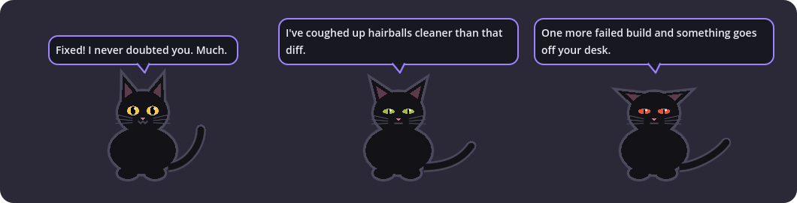
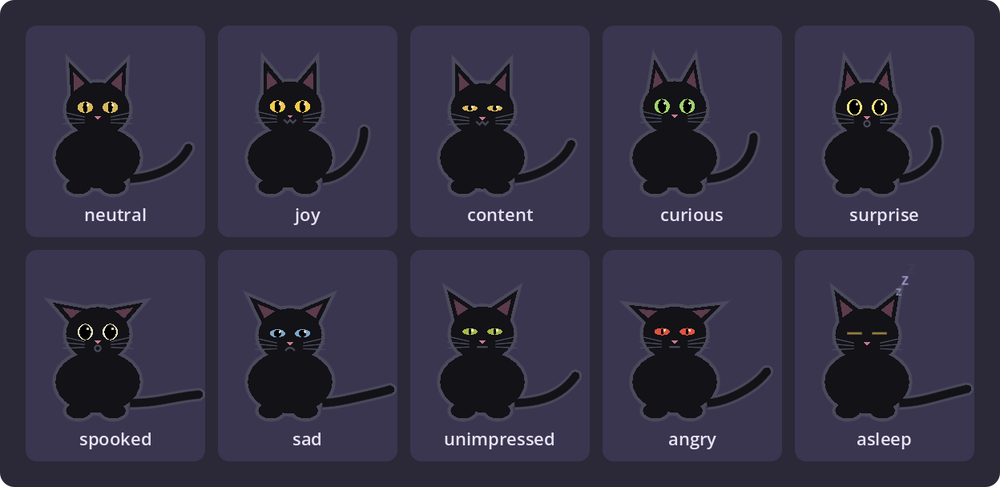

# Sable

A black-cat desktop familiar for Windows. She sits at the bottom of your screen,
watches your Claude Code sessions, and comments on them through speech bubbles:
snark when you're winning, emotional support when the build is on fire. You can
IM her in a retro chat window, ask her for a vibe check from inside Claude Code
(`/sable`), and she keeps a diary about your day.



Everything is local. Her brain is a llama.cpp server you run, her voice is
Pocket TTS on your CPU, and nothing leaves your network.

Built with Godot 4.7.2 (GDScript) as a small native app, not Electron: a few
percent of one CPU core when idle.

## What she does

- **Speech bubbles** reacting to Claude Code: new sessions, failing tool streaks,
  the fix finally landing, long grinds, a permission prompt you've ignored.
- **Voice** (optional): Pocket TTS on CPU, preset voices or your own designed one.
- **Chat**: right-click her, **Chat with Sable...**. An AIM-style window; everything
  she says in the bubble lands there too, so you can reply to it.
- **Eyes** (needs a vision model): right-click her, **What do you make of my
  screen?**, and she screenshots the screen under your mouse and reacts. Paste
  (Ctrl+V) or drop images into the chat window to show her things.
- **Web search** (optional): point `SABLE_SEARCH_URL` at a SearXNG instance and
  she can look things up and read pages when you ask her something in chat.
  Each search and page shows up as a gray note in the thread.
- **Memory**: she picks up lasting facts from chat (your favorite drink, your
  sister's name). View, edit or wipe them in Settings.
- **Diary**: each evening she writes an entry about your day.
- **Wanders** along the taskbar now and then; drag her anywhere.
- **Away detection**: when you're idle she goes quiet, has a few private thoughts,
  and welcomes you back.
- **`/sable` skill** for Claude Code: "What's your take on this, Sable?" gets her
  honest read of your last turn or two.

### Moods

Her face follows what's happening: a streak of failures, a long grind, the fix
landing. Moods ease in and out, and her eyes, ears, pupils and tail all shift.



She's drawn in code, so she scales cleanly. Drop your own pose PNGs in
`art/sable/` to replace her (see [DESIGN.md](DESIGN.md) section 5). To
re-render these images after changing her look, run
`& $env:GODOT --path godot --script res://dev/render_moods.gd` (and
`render_hero.gd`) from the repo root.

## Requirements

- Windows 10/11.
- A **llama.cpp server** (`llama-server`) reachable from your machine, with any
  chat model. Sable uses its OpenAI-style API plus `/health` and `/slots`.
  Recommended: run it with two slots so she never evicts your coding agent's cache:

  ```
  llama-server -m your-model.gguf -np 2 -c 16384 --host 0.0.0.0 --port 8080
  ```

  With a single-slot server, set `SABLE_LLM_SLOT=-1`. If the server is down she
  naps and uses canned lines. For screen peeks and chat images, use a
  vision-capable model and pass its projector: `--mmproj mmproj-file.gguf`.
- **Node.js** (Claude Code hook and the `/sable` vibe check).
- **uv** (installs the Pocket TTS voice). Skip voice with `setup.ps1 -SkipTts`.
- **Godot 4.7.2** only if you run from source or build the package.

## Quick start

From a packaged zip (`Sable-<version>.zip`):

```powershell
.\setup.ps1            # asks your name, server URL, voice...; installs TTS, hook, skill
.\Sable.exe
```

From source:

```powershell
.\setup.ps1            # same questions; also set GODOT to your Godot 4.7.2 exe when asked to edit .env
.\run.ps1
```

To build the standalone folder and zip yourself: `.\tools\package.ps1`
(needs the Godot 4.7.2 Windows export templates; see [PACKAGING.md](PACKAGING.md)).

## Customizing

`setup.ps1` writes your answers to `.env` (gitignored; template in
[.env.example](.env.example)). Re-run `.\setup.ps1 -Customize` any time, then
restart Sable.

| Key | What it does |
|---|---|
| `SABLE_USER_NAME` | What Sable calls you |
| `SABLE_LLM_URL` | Your llama.cpp server |
| `SABLE_LLM_SLOT` | Her slot (1 with `-np 2`; -1 = any) |
| `SABLE_BRAIN_NAME` | What she calls the box her brain runs on ("the GPU", "the B70", "Dave's workstation") |
| `SABLE_TTS_URL`, `SABLE_TTS_VOICE` | Voice server and preset voice |
| `SABLE_PERSONA_DIR` | Folder with her `SOUL.md` (personality) and optional `USER.md` (about you) |
| `SABLE_SEARCH_URL`, `SABLE_SEARCH_ENGINES` | SearXNG instance for web search in chat (JSON format enabled), optional engine list |
| `GODOT` | Godot exe, for `run.ps1` and `tools/package.ps1` |

Real environment variables override `.env`, and anything you change in Sable's
Settings window overrides both.

- **Personality**: edit [persona/SOUL.md](persona/SOUL.md), or point
  `SABLE_PERSONA_DIR` at your own folder. `{user}` and `{brain}` in any prompt
  file are filled in from `.env`.
- **About you**: copy `persona/USER.example.md` to `persona/USER.md` (setup offers to).
- **pi-persona users**: point `SABLE_PERSONA_DIR` at your pi agent dir
  (e.g. `C:/Users/you/.pi/agent`) and Sable mirrors its mood too.
- **Voice**: presets are listed in [tts/VOICE_RUNBOOK.md](tts/VOICE_RUNBOOK.md),
  which also walks through designing your own voice locally.
- **Art**: the cat is drawn in code; drop pose PNGs in `art/sable/` to replace it
  (spec in [DESIGN.md](DESIGN.md) section 5).

## Privacy

- Sable reads your Claude Code activity through hooks and transcripts on your own
  disk, and sends snippets only to the llama.cpp server you configured.
- To keep projects out of it, list them under **Settings > Claude Code > Ignore
  these projects**.
- **Settings > Window > Hide Sable from screen sharing** keeps her out of
  screen shares and recordings. Prompts tell her to stay SFW, but she's an LLM:
  use Do Not Disturb (tray menu) in meetings.
- She only looks at your screen when you ask (the menu item). The screenshot
  goes to your LLM server and a downscaled copy is kept with the chat history
  (Clear in the chat window deletes them).
- Web search is off unless you set `SABLE_SEARCH_URL`. With it on, her search
  terms go to your SearXNG (and from there to its search engines), and she can
  open pages from her results or links you send her, nothing else.
- Chat history, chat images, memory, the activity log and the diary live in
  `%APPDATA%\Godot\app_userdata\Sable Pet\`.

## Uninstall

```powershell
.\setup.ps1 -Uninstall    # removes the Claude hook, the /sable skill and autostart
```

Then delete the folder (and `%APPDATA%\Godot\app_userdata\Sable Pet\` to wipe her memories).

## More

- [DESIGN.md](DESIGN.md): how it works and why.
- [REVIEW.md](REVIEW.md): code review notes and known deferred items.
- [PACKAGING.md](PACKAGING.md): building the standalone package.

## License

[PolyForm Noncommercial 1.0.0](LICENSE.md). Free to use, modify and share for
personal, hobby, research, educational and other noncommercial purposes. Not
for commercial use: no selling it, bundling it into a paid product or service,
or otherwise using it to make money. For anything else, ask.

Third-party pieces keep their own licenses: Godot (MIT), Pocket TTS and its
voices, and whatever model you load into llama.cpp.
